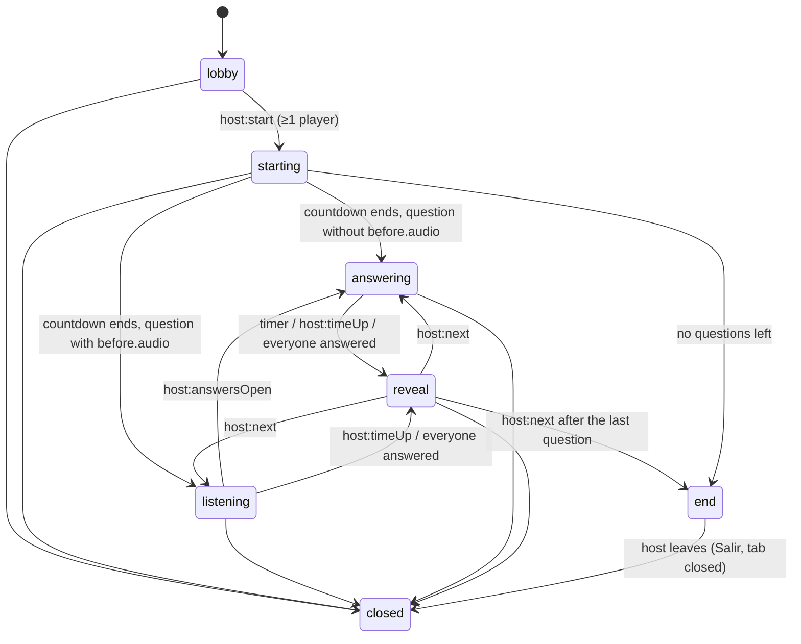
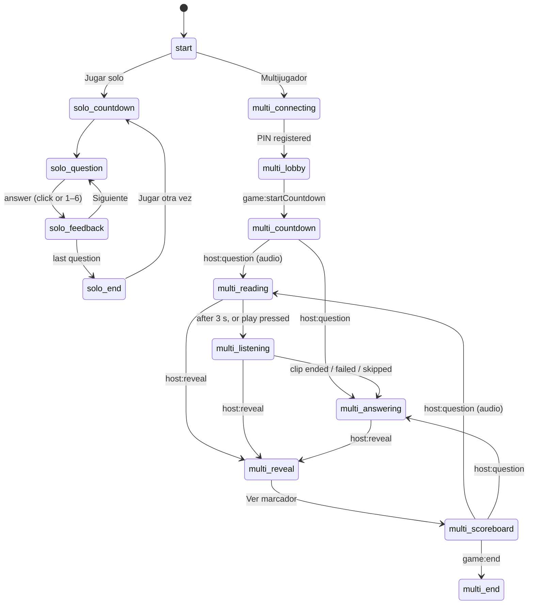
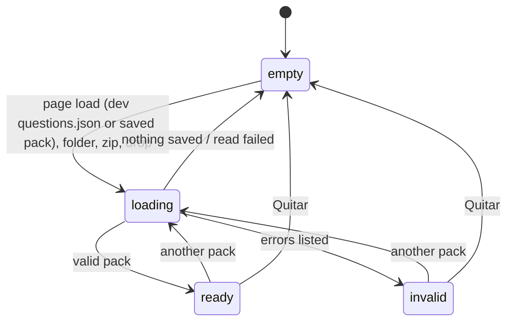
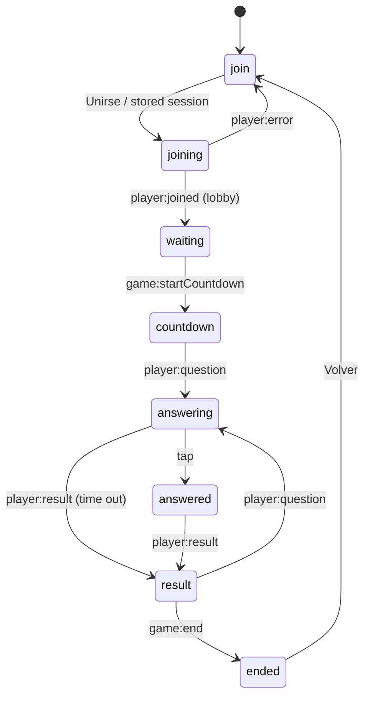

# State machines

Recuerdoot used to keep its flow in scattered flags (`game.phase` plus `answersOpen`, `mode`, `isPlaying`, `soloAnswered`, `questionCountdownRunning`, `audioEndedAction`, checks like `reveal-screen.classList.contains("active")`...). Every one of those was an implicit state machine. They are now explicit.

- **Transition tables** for the four flow machines live in [`assets/js/state-machines.js`](../assets/js/state-machines.js) (`MACHINES.game`, `MACHINES.host`, `MACHINES.pack`, `MACHINES.player`). Both pages and the Node tests load the same file.
- **`createStateMachine(definition)`** validates the table, exposes `state`, `is(...)`, `can(target)`, `transition(target)` and `subscribe(listener)`. Re-entering the current state is always allowed, so a screen can re-render when the host pushes the same phase again (for example after a rejoin). Because `transition(current)` succeeds, user actions are guarded with `is(...)` first so a double click or key press cannot run twice.
- Invalid transitions are ignored with a console warning in the page controllers. In the match engine they **throw**, because every engine transition is guarded first, so an invalid one is a bug (`match-host.js` catches and logs it).
- `test/state-machines.test.js` checks that every state is reachable, that every host state can exit to `start`, that `closed` is terminal, and which states can reach `answered`.

Debugging and agent hooks:

| Where | How to read the current state |
|-------|-------------------------------|
| Match engine | `getMatchState()` in the host console → `{ pin, phase, questionIndex, totalQuestions, answered, players: [{ name, score, connected }] }` (no answers, connection ids or player ids) |
| Host page | `document.body.dataset.state` / `dataset.mode`, or `getHostState()` in the console |
| Quiz card | `#pack-card[data-state]`, or `getHostState().pack` |
| Player page | `document.body.dataset.state`, or `getPlayerState()` in the console |

## 1. Game (match engine) — `MACHINES.game`

Owned by `Game` in [`assets/js/game-engine.js`](../assets/js/game-engine.js), which runs in the host browser through [`match-host.js`](../assets/js/match-host.js). One match at a time.

| State | Meaning |
|-------|---------|
| `lobby` | Players can join. Leaving removes the player. |
| `starting` | 5 s start countdown (`game:startCountdown`). |
| `listening` | Audio question: the host reads (3 s) and plays the clip. Players already see the options and may answer. Replaces the old `answersOpen = false`. |
| `answering` | Answer window: 20 s normally, 10 s after an audio clip. |
| `reveal` | Results sent (`host:reveal`, `player:result`). |
| `end` | Final leaderboard sent (`game:end`). |
| `closed` | Torn down. `player:gameOver` is sent only if the match had not reached `end`, so final results stay on players' phones. |

"Everyone answered" means every **connected** player has answered. A disconnected player no longer blocks the round.

### Sub-machines inside a game

- **Player connection**: `connected ↔ disconnected` (`player.connected`). A data channel closes, or stays silent for 10 s (heartbeat), and match-host calls `disconnect`. In `lobby` that removes the player; later it only marks them, and they can rejoin with their `playerId`.
- **Answer per player and question**: `pending → answered`, or `timed out` at reveal (streak resets).
- **Timer**: a single `#timer` scheduled by `#schedule()` and cleared on every phase change, so two timers can never race.

## 2. Host page — `MACHINES.host`

Owned by [`assets/js/host.js`](../assets/js/host.js). The state alone decides the visible screen (`SCREEN_BY_STATE`), the nav (progress, PIN chip, *Salir*) and the phase chip. It replaces `mode`, `soloAnswered` and the DOM class checks.

Every state except `start` can also go back to `start` (*Salir* + confirmation, *Volver*, *Nueva partida*, match creation failed). Going back closes the match (`match.close`), which tells phones that have not seen the final results and stops listening for the PIN. Closing the tab does the same on `pagehide`, and a page restored from the back/forward cache goes back to `start`.

`multi-connecting` waits for the PeerJS id to be registered (at most 12 s, then an error toast and back to `start`). Solo and multiplayer can only start when the pack card is `ready`, and the card is locked outside `start`.

| State | Screen | Notes |
|-------|--------|-------|
| `start` | start | Quiz card, multiplayer and solo entry points. |
| `solo-countdown` | (overlay) | Start countdown over the current screen. |
| `solo-question` | question | Tiles clickable, keys 1–6. |
| `solo-feedback` | question + sheet | Feedback sheet with revealed media. |
| `solo-end` | solo end | Score and message. |
| `multi-connecting` | start | *Multijugador* shows "Creando partida…" while the PIN is registered. |
| `multi-lobby` | lobby | PIN, QR, players, waiting music. |
| `multi-countdown` | lobby (overlay) | Start countdown. |
| `multi-reading` | question | 3 s before the clip plays automatically ("Atentos al audio"). |
| `multi-listening` | question | Clip playing ("Escuchando"). Pressing the play button skips to answers. |
| `multi-answering` | question | Countdown ring running ("¡A responder!"). |
| `multi-reveal` | reveal | Chart and revealed media. |
| `multi-scoreboard` | scoreboard | Previous order, then animated new order. |
| `multi-end` | podium | Winner and top 5. |

Fixed bugs that came from the implicit version:

- Pausing the clip while listening left the server waiting for `host:answersOpen` forever. Now it opens the answers.
- If autoplay was blocked or the audio file failed, the answer countdown never started and the round got stuck. Now answers open straight away.
- Player names in the lobby were injected as HTML. They are escaped now.

### Host sub-machines (encapsulated controllers)

| Controller | States | File |
|------------|--------|------|
| Question countdown (`questionTimer`) | `idle → running → finished`. `finish()` plays the gong once, whether time ran out or the round ended early. | `host.js` |
| Foreground audio | `idle ↔ playing` with a one-shot `onEnded`; pending source swapped after the fade-out. | `host-media.js` |
| Background music | `stopped ↔ playing`, ducked while foreground audio plays. | `host-media.js` |
| Scoreboard | `settling → ready` (next button disabled until rows have moved). | `host.js` |
| Start countdown overlay | `hidden ↔ counting` | `game-shared.js` |
| Theme | `system ↔ light ↔ dark` (stored choice) | `ui-shell.js` |

## 3. Quiz card — `MACHINES.pack`

Owned by [`assets/js/host-pack.js`](../assets/js/host-pack.js) on the host start screen.

| State | Card shows |
|-------|------------|
| `empty` | How to load a quiz, folder/zip buttons, AI guide. Start buttons disabled. |
| `loading` | "Cargando quiz…", buttons disabled. A newer load always wins over a slower one. |
| `ready` | Pack name, question and file counts, source. Start buttons enabled. Picked packs are saved to IndexedDB. |
| `invalid` | Up to 6 problems in Spanish with the question number. Nothing is saved, so a previously saved pack stays. |

## 4. Player page — `MACHINES.player`

Owned by [`assets/js/player.js`](../assets/js/player.js). The host is authoritative, so in-game states accept almost any host push (a reconnect may land anywhere).

Also allowed, for rejoins and server pushes: `joining`, `waiting`, `countdown` and `result` → `answered` (rejoin after answering); `waiting`, `countdown` → `result`; any in-game state → `ended` (`game:end`, `player:gameOver`) or → `join` (`player:error`).

| State | Screen |
|-------|--------|
| `join` | Join form. |
| `joining` | Join form, button shows "Uniéndote…". |
| `waiting` | "Estás dentro". |
| `countdown` | Waiting screen with the start overlay. |
| `answering` | Answer grid; chip shows "Escucha el audio" or "¡Responde!". |
| `answered` | Answer grid locked; chip shows "Respuesta enviada". |
| `result` | Correctness, points, position, total, streak. |
| `ended` | Final position, or the reason the match ended. |

Side states: **connection** (`online ↔ reconnecting`, shown as a nav chip; `peer-transport.js` retries every 2 s and right away when the phone comes back from the lock screen; a PIN nobody hosts any more ends the match on the phone) and **session** (`sessionStorage` holds `{ pin, name, playerId }` so a reload rejoins automatically, unless the URL PIN belongs to a different match).

Fixed bugs that came from the implicit version:

- *Volver* reloaded the page with the old `?pin=` locked in the input. Now it returns to an editable form and clears the URL.
- A wrong PIN from a QR left the PIN field read-only. It becomes editable on error.
- The listening screen and the `player:wait` handler were dead code (the server never sent `player:wait`). They were removed. The answer screen now shows the listening/answering status instead.
